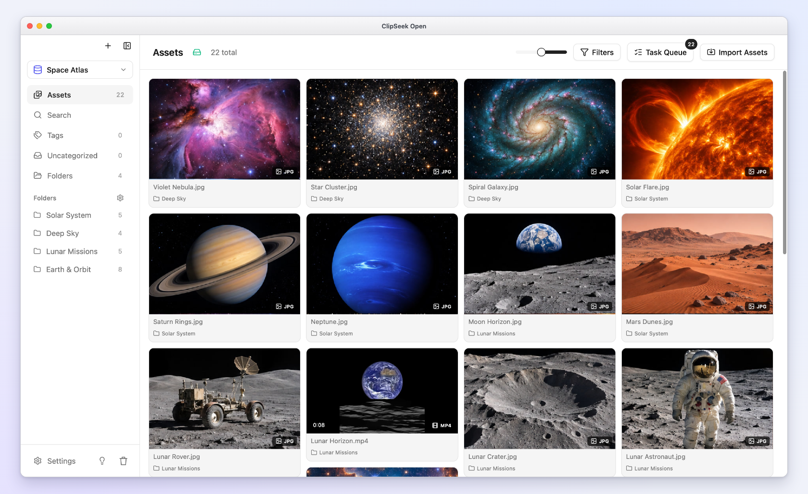
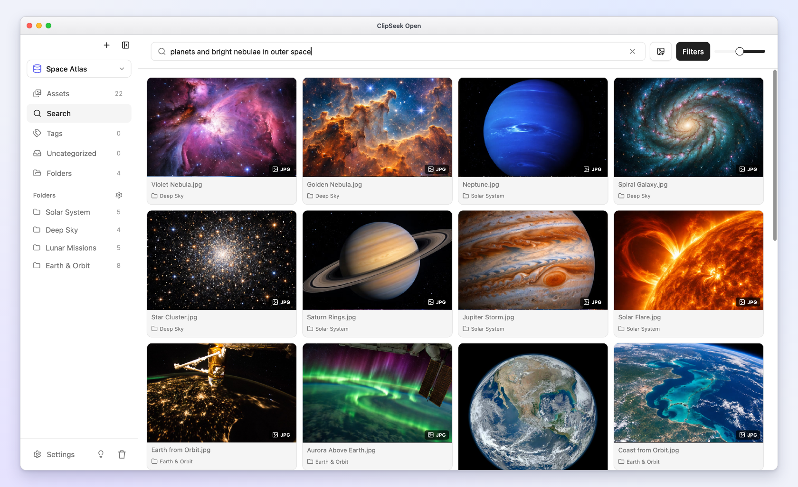

<h1 align="center">ClipSeek Open</h1>

<p align="center">
  <strong>Find photos and short videos with a sentence.</strong><br>
  An open source desktop app powered by EmbeddingGemma 2. Search by text or reference image, with all media processing on your computer.
</p>

<p align="center">English · <a href="README.zh-CN.md">简体中文</a></p>

<p align="center">
  <a href="https://github.com/clipseeklab/clipseek/releases/tag/v0.1.0"></a>
  <a href="#features"></a>
  <a href="LICENSE"></a>
</p>

<p align="center">
  <a href="https://github.com/clipseeklab/clipseek/releases/download/v0.1.0/ClipSeek-Open_0.1.0_macos-arm64.dmg"></a>
  <a href="https://github.com/clipseeklab/clipseek/releases/download/v0.1.0/ClipSeek-Open_0.1.0_macos-x64.dmg"></a>
  <a href="https://github.com/clipseeklab/clipseek/releases/download/v0.1.0/ClipSeek-Open_0.1.0_windows-x64-setup.exe"></a>
</p>

<p align="center"><a href="#download-010">Download</a> · <a href="#features">Features</a> · <a href="#system-requirements">System requirements</a> · <a href="#contributing">Contributing</a></p>

<p align="center">
  
</p>

## Features

- **Natural-language search:** find photos and videos by describing their visual content.
- **Image similarity search:** use a reference image to find similar scenes.
- **Short-video search:** build one embedding per complete video, up to **32 seconds** long. Search results return the whole video.
- **Media organization:** organize assets with folders and tags. Import by reference without making an extra copy of the original files.
- **Model precision:** use **Q8** by default, or choose Q4 / FP32.
- **MCP interface:** optionally let AI clients search your local library through the authenticated [MCP interface](docs/mcp.md).

## System requirements

| Platform                      | Operating system             | Inference                                   |
| ----------------------------- | ---------------------------- | ------------------------------------------- |
| Apple Silicon (M1 or newer)   | macOS 14+                    | CoreML GPU on macOS 15+; Metal/CPU fallback |
| Intel Mac (64-bit)            | macOS 14+                    | CPU                                         |
| Intel/AMD Windows PC (64-bit) | Windows 10 22H2 / Windows 11 | CPU                                         |

**Recommended for Q8:** 16 GB RAM, an SSD, and 10 GB free space for the app, model, and initial caches. Allow extra space for library thumbnails, indexes, and additional precisions. The Q8 download is about 540 MB. Lower-memory devices have not been validated.

Apple Silicon and Windows 10 have been tested on physical devices. Intel macOS is tested in GitHub Actions; physical macOS 14+ Intel validation is still pending.

## Download 0.1.0

| Platform            | Installer                                                                                                                        |
| ------------------- | -------------------------------------------------------------------------------------------------------------------------------- |
| macOS Apple Silicon | [Download DMG](https://github.com/clipseeklab/clipseek/releases/download/v0.1.0/ClipSeek-Open_0.1.0_macos-arm64.dmg)             |
| macOS Intel         | [Download DMG](https://github.com/clipseeklab/clipseek/releases/download/v0.1.0/ClipSeek-Open_0.1.0_macos-x64.dmg)               |
| Windows x64         | [Download installer](https://github.com/clipseeklab/clipseek/releases/download/v0.1.0/ClipSeek-Open_0.1.0_windows-x64-setup.exe) |

[Release notes and SHA-256 checksums](https://github.com/clipseeklab/clipseek/releases/tag/v0.1.0). Installers are unsigned; macOS packages are not notarized.

## Screenshots



The demo library uses NASA imagery and generated space illustrations. See the [media credits](THIRD_PARTY_NOTICES.md#documentation-demo-media).

## Getting started

1. Launch the app, download a model, and create a library.
2. Add local photos or videos and wait for indexing.
3. Search for a scene, such as “a sunset by the sea.”

The interface defaults to English; Chinese is available in settings. Change precision in **Settings → Model management**. This rebuilds the index. Initial model download requires internet access; subsequent processing is local.

## Development

Install Node.js 22.18+, Rust, and [Tauri 2 prerequisites](https://v2.tauri.app/start/prerequisites/).

```sh
git clone https://github.com/clipseeklab/clipseek.git
cd clipseek
npm ci
npm run desktop
```

The first run downloads checksum-pinned macOS or Windows x64 native dependencies. For private repositories, use an authenticated GitHub CLI with `CLIPSEEK_RUNTIME_USE_GH=1`. Use `npm run desktop:build` to build locally, or follow the [installer guide](docs/releases.md) for on-demand macOS Apple Silicon / Intel and Windows x64 GitHub Actions builds. Ordinary commits do not trigger installer builds.

## Contributing

[Issues](https://github.com/clipseeklab/clipseek/issues) and pull requests are welcome. See [testing](docs/testing.md), [coding guidelines](docs/coding-standards.md), and [architecture](docs/architecture.md). Keep credentials, personal media, libraries, models, and build artifacts out of commits.

See [inference notes](docs/inference.md) for accuracy and performance limits.

## License

An independent project based on ClipSeek, licensed under [Apache-2.0](LICENSE). Model terms are separate; see [third-party notices](THIRD_PARTY_NOTICES.md).
