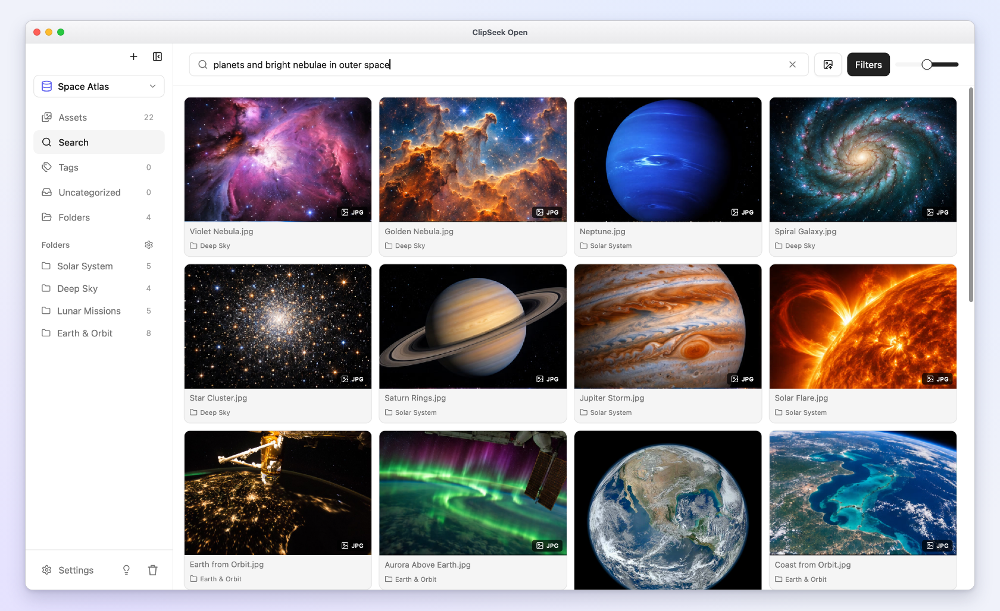
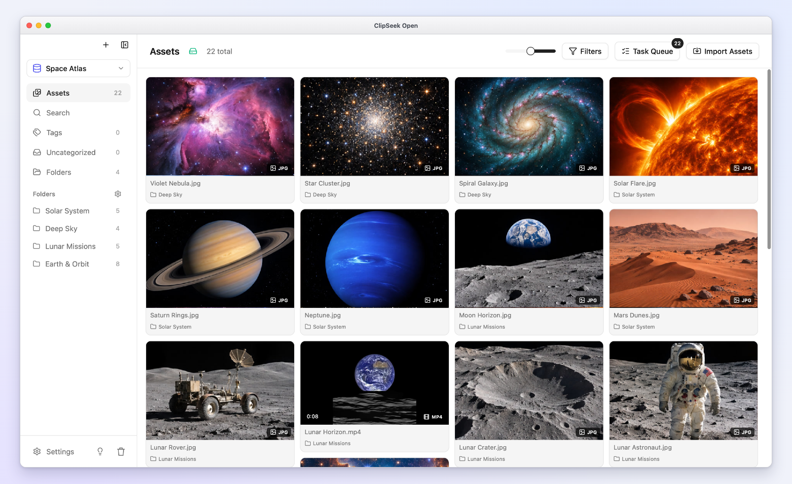

# ClipSeek Open

[English](README.md) · 简体中文

用自然语言或图片搜索本地照片和视频。素材处理在本机完成，无需账号或云服务。

- 通过文件夹和标签管理素材，原文件保留在原位置。
- 支持最长 **32 秒**的视频，搜索结果返回完整视频。
- 使用 EmbeddingGemma 2，默认 **Q8**，可选 Q4 / FP32。
- 可通过 [MCP 接口](docs/mcp.md)连接 AI 客户端。

## 下载 0.1.0

| 平台                | 安装包                                                                                                                     |
| ------------------- | -------------------------------------------------------------------------------------------------------------------------- |
| macOS Apple Silicon | [下载 DMG](https://github.com/clipseeklab/clipseek/releases/download/v0.1.0/ClipSeek-Open_0.1.0_macos-arm64.dmg)           |
| macOS Intel         | [下载 DMG](https://github.com/clipseeklab/clipseek/releases/download/v0.1.0/ClipSeek-Open_0.1.0_macos-x64.dmg)             |
| Windows x64         | [下载安装程序](https://github.com/clipseeklab/clipseek/releases/download/v0.1.0/ClipSeek-Open_0.1.0_windows-x64-setup.exe) |

[更新说明与 SHA-256 校验文件](https://github.com/clipseeklab/clipseek/releases/tag/v0.1.0)。安装包暂未签名，macOS 版本尚未公证。

## 软件截图



<details>
<summary>素材库界面</summary>



</details>

演示图片来自 [NASA](THIRD_PARTY_NOTICES.md#documentation-demo-media)，演示视频为基于这些图片生成的短循环。

## 运行要求

| 平台                            | 操作系统                     | 推理方式                                    |
| ------------------------------- | ---------------------------- | ------------------------------------------- |
| Apple Silicon（M1 及更新芯片）  | macOS 14+                    | macOS 15+ 使用 CoreML GPU，可回退 Metal/CPU |
| Intel Mac（64 位）              | macOS 14+                    | CPU                                         |
| Intel/AMD Windows 电脑（64 位） | Windows 10 22H2 / Windows 11 | CPU                                         |

**Q8 推荐配置：**16 GB 内存、SSD，以及 10 GB 可用空间，用于应用、模型和初始缓存。素材缩略图、索引和其他精度的模型需要额外空间。Q8 模型下载约 540 MB，低内存设备尚未验证。

已在 Apple Silicon 和 Windows 10 真机测试；Intel macOS 已通过 GitHub Actions 测试，仍待 macOS 14+ Intel 真机验证。

## 开始使用

1. 启动应用，下载模型并创建素材库。
2. 添加本地照片或视频，等待索引完成。
3. 输入场景描述，例如“海边的日落”。

界面默认英文，可在设置中切换中文。在**设置 → 模型管理**中更换精度会重建索引。首次下载模型需要联网，之后的素材处理在本地进行。

## 本地开发

安装 Node.js 22.18+、Rust 和 [Tauri 2 开发依赖](https://v2.tauri.app/start/prerequisites/)。

```sh
git clone https://github.com/clipseeklab/clipseek.git
cd clipseek
npm ci
npm run desktop
```

首次运行会下载并校验预构建的 macOS 或 Windows x64 原生依赖；私有仓库需先登录 GitHub CLI，并设置 `CLIPSEEK_RUNTIME_USE_GH=1`。本地打包使用 `npm run desktop:build`；GitHub Actions 支持构建 macOS Apple Silicon / Intel 和 Windows x64 安装包，详见[安装包指南](docs/releases.md)。普通提交不会触发安装包构建。

## 参与贡献

欢迎提交 [Issue](https://github.com/clipseeklab/clipseek/issues) 或 Pull Request。开发前请阅读[测试说明](docs/testing.md)、[代码规范](docs/coding-standards.md)和[架构说明](docs/architecture.md)。不要提交密钥、个人素材、素材库、模型或构建产物。

精度和性能限制见[推理说明](docs/inference.md)。

## 许可证

基于 ClipSeek 的独立项目，采用 [Apache-2.0](LICENSE)。模型适用单独的条款，详见[第三方声明](THIRD_PARTY_NOTICES.md)。
